:orphan:

.. _benchmarks_archiving:

####################
Archiving Benchmarks
####################

The following plots compare the performance of archiving algorithms in `moocore`_, `moarchiving`_ and `jMetalPy`_.

The sequences are generated using :func:`~moocore.generate_ndset` and :func:`~moocore.generate_sequence`.

The source code for the benchmarks below can be found at https://github.com/multi-objective/moocore/tree/main/python/benchmarks .

Unbounded Archiving
-------------------

This benchmark compares :func:`moocore.UnboundedArchive`,
|moarchiving_get_mo_archive|_ and |jmetal_ndarchive|_.  Each archive is given
the number of points in the x-axis, one at a time. We measure the CPU time
required to archive the whole sequence of points and divide it by the number of
points, which gives an estimation of the time to process each point for
different input sizes.  In addition, the plots show the total time required by
:func:`~moocore.filter_dominated` to process the input sequence. The time
required by :func:`~moocore.filter_dominated` can be seen as an upper-bound.

2D
~~

|unbarchive_add_bench-glas2017,c=0.5-2d-time| |unbarchive_add_bench-glas2017,c=2.0-2d-time|

|unbarchive_add_bench-hypercube-uniform-2d-time| |unbarchive_add_bench-hypercube-uniform-rep4-2d-time|

|unbarchive_add_bench-hypercube-ndsort=-1-2d-time| |unbarchive_add_bench-hypercube-ndsort=1-2d-time|

|unbarchive_add_bench-inverted-simplex-2d-time| |unbarchive_add_bench-within-concave-sphere-2d-time|

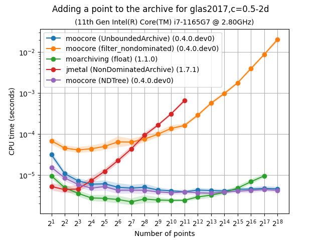

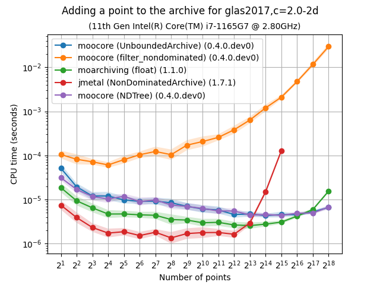

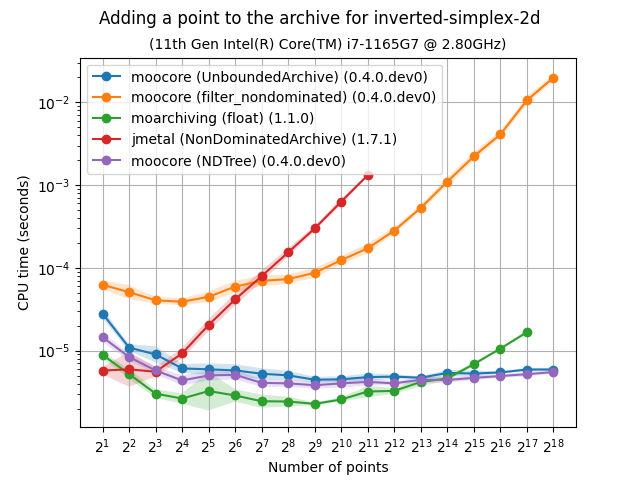

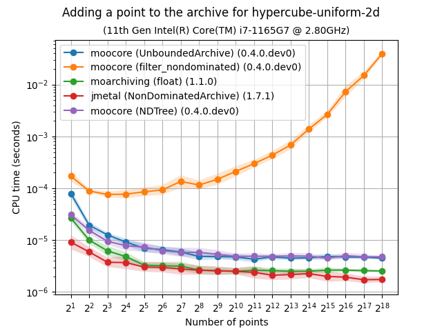

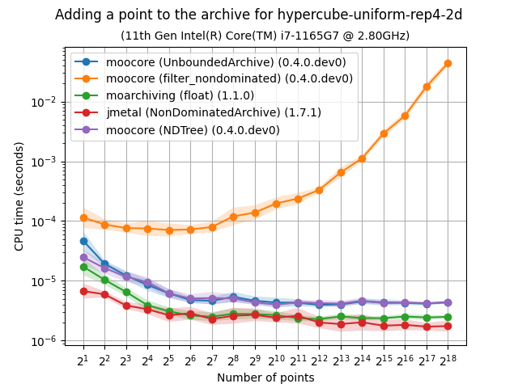

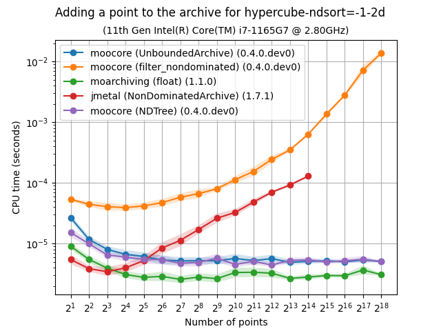

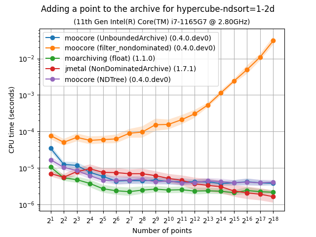

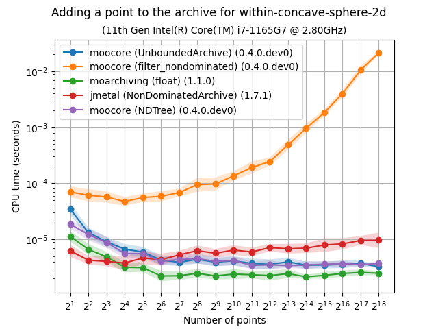

3D
~~

|unbarchive_add_bench-glas2017,c=0.5-3d-time| |unbarchive_add_bench-glas2017,c=2.0-3d-time|

|unbarchive_add_bench-hypercube-uniform-3d-time| |unbarchive_add_bench-hypercube-uniform-rep4-3d-time|

|unbarchive_add_bench-hypercube-ndsort=-1-3d-time| |unbarchive_add_bench-hypercube-ndsort=1-3d-time|

|unbarchive_add_bench-inverted-simplex-3d-time| |unbarchive_add_bench-within-concave-sphere-3d-time|

|unbarchive_add_bench-concave-cliff-3d-time| |unbarchive_add_bench-convex-cliff-3d-time|

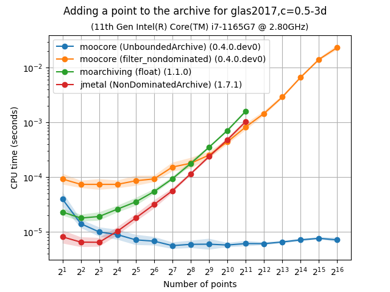

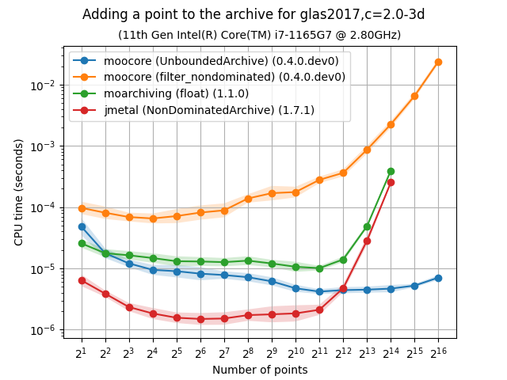

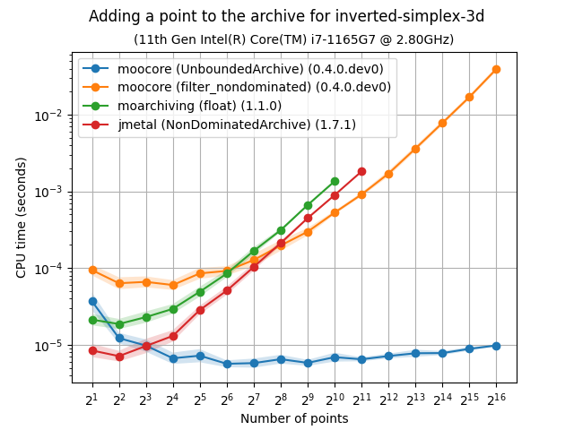

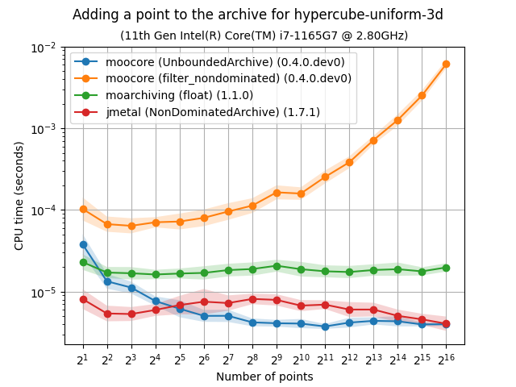

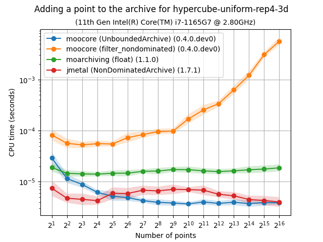

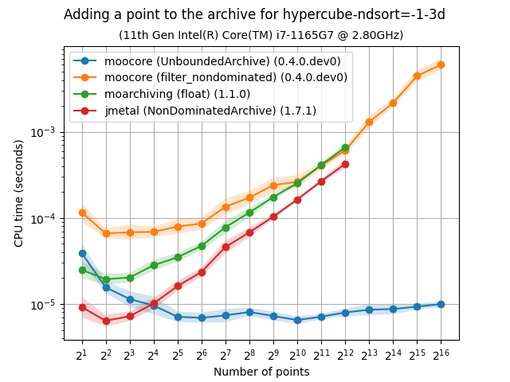

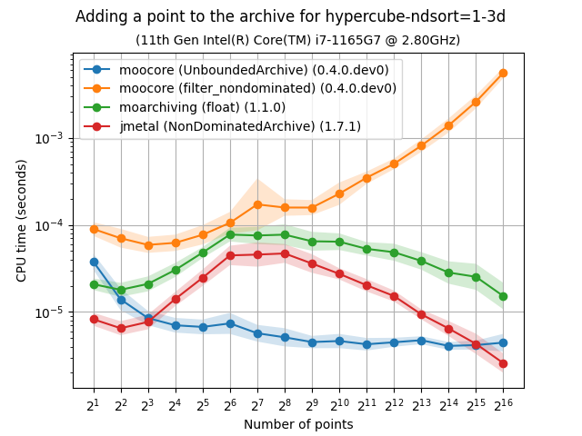

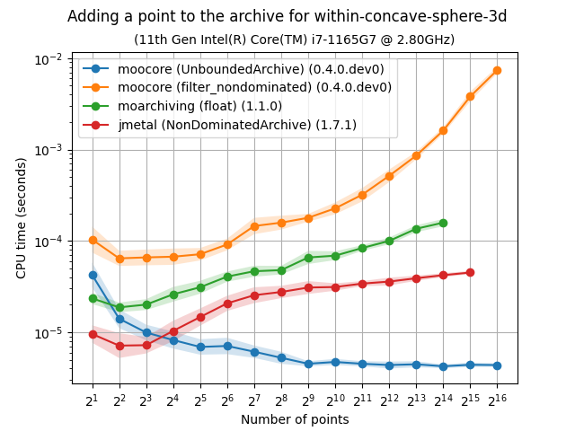

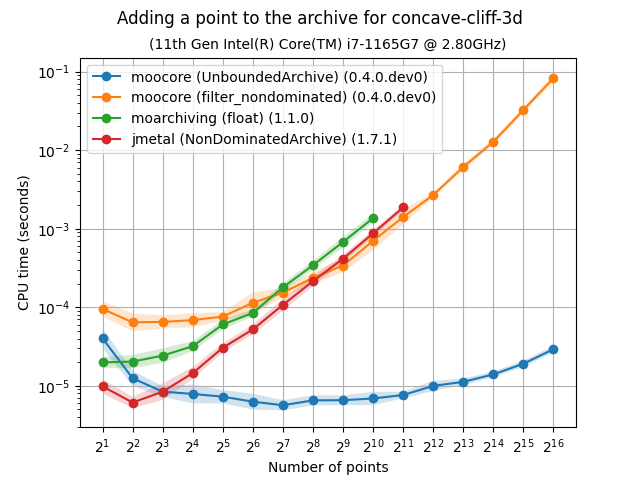

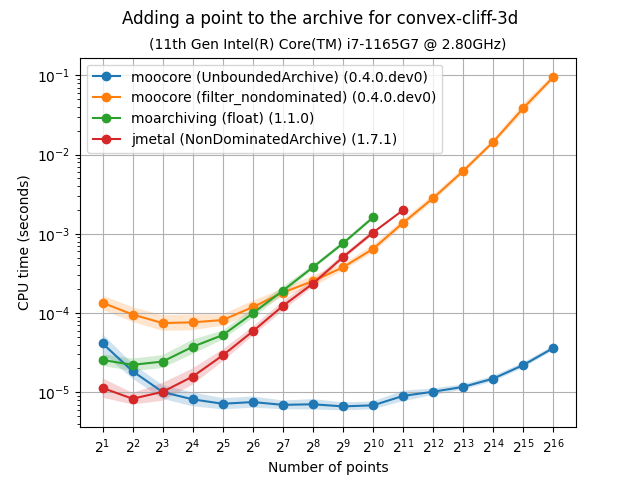

4D
~~

|unbarchive_add_bench-glas2017,c=0.5-4d-time| |unbarchive_add_bench-glas2017,c=2.0-4d-time|

|unbarchive_add_bench-hypercube-uniform-4d-time| |unbarchive_add_bench-hypercube-uniform-rep4-4d-time|

|unbarchive_add_bench-hypercube-ndsort=-1-4d-time| |unbarchive_add_bench-hypercube-ndsort=1-4d-time|

|unbarchive_add_bench-inverted-simplex-4d-time| |unbarchive_add_bench-within-concave-sphere-4d-time|

|unbarchive_add_bench-concave-cliff-4d-time| |unbarchive_add_bench-convex-cliff-4d-time|

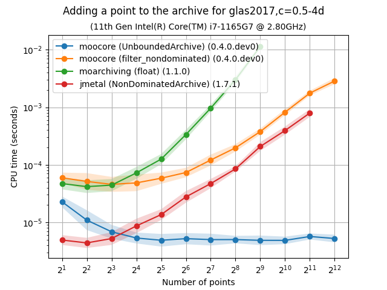

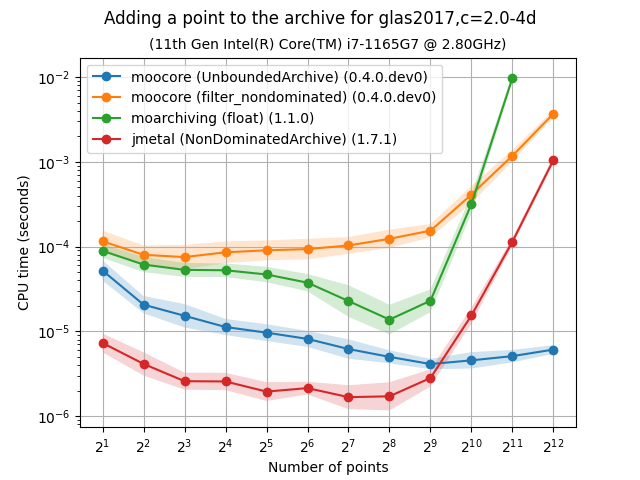

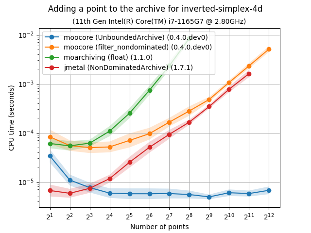

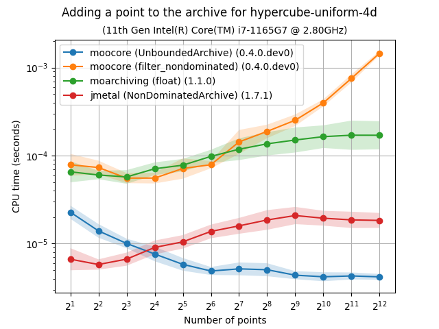

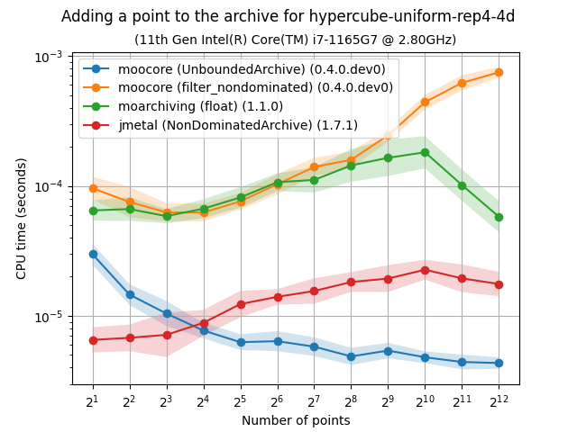

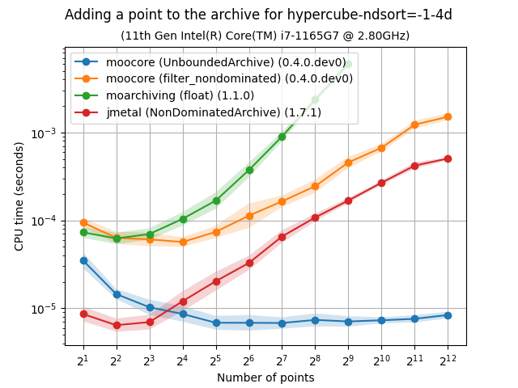

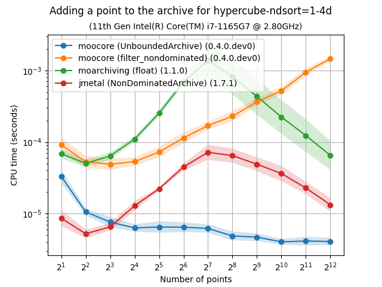

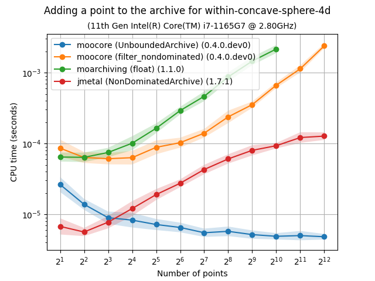

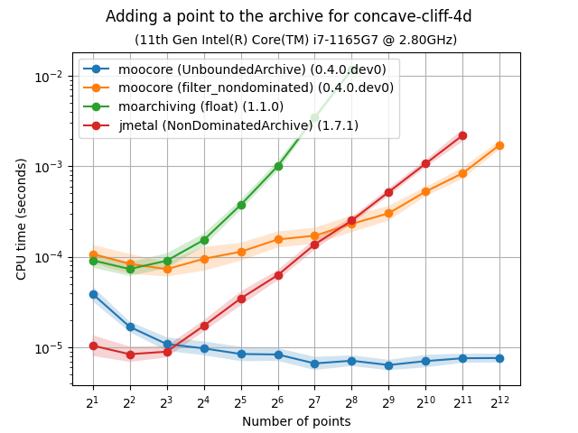

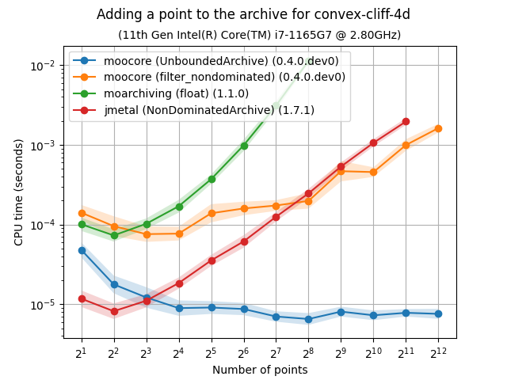

.. _jMetalPy: https://jmetal.github.io/jMetalPy/index.html
.. _moarchiving: https://cma-es.github.io/moarchiving/
.. _moocore: https://multi-objective.github.io/moocore/python/

.. The :func: role expects a Python cross-reference, not an arbitrary URL.
   Since reStructuredText does not support nested inline markup, use a
   substitution to combine code formatting with an external hyperlink.
   See https://www.docutils.org/FAQ.html#is-nested-inline-markup-possible

.. |moarchiving_get_mo_archive| replace:: :code:`moarchiving.get_mo_archive`
.. _moarchiving_get_mo_archive: https://cma-es.github.io/moarchiving/moarchiving-apidocs/moarchiving.get_archive.html#get_mo_archive

.. |jmetal_ndarchive| replace:: :code:`jmetal.util.archive.NonDominatedSolutionsArchive`
.. _jmetal_ndarchive: https://github.com/jMetal/jMetalPy/blob/1d0116f0d3100aa30a6597edf69ee59d5a9b7fdb/src/jmetal/util/archive.py#L110
